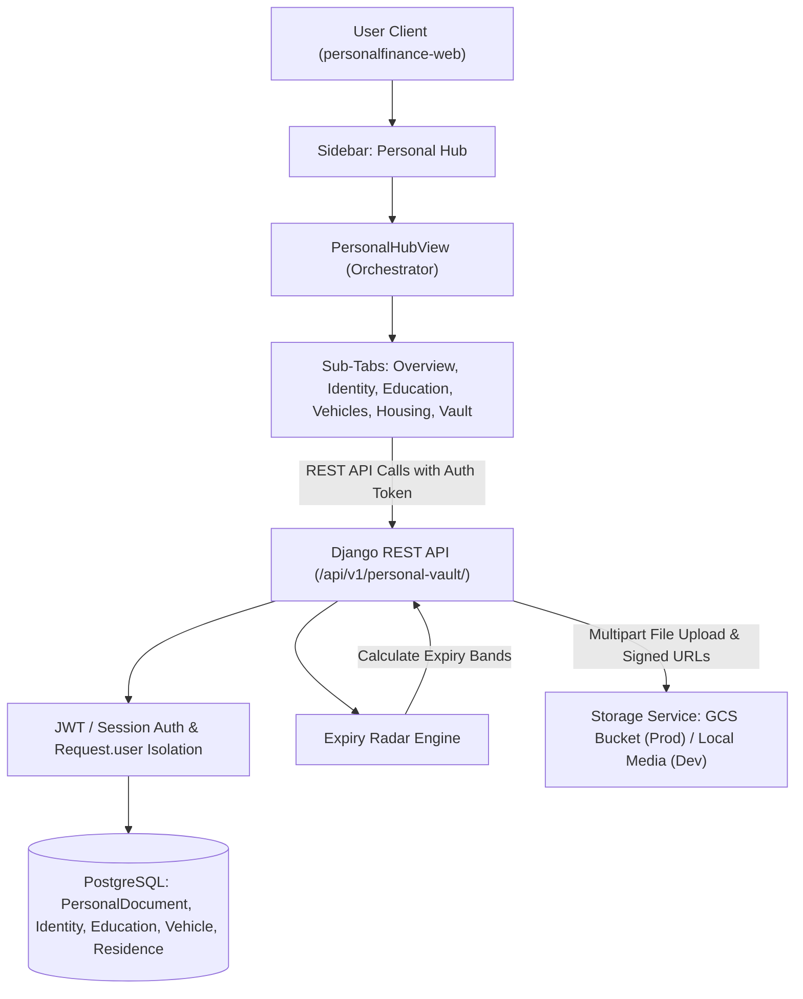

# Personal Information & Vault Subsystem Architecture

## 1. Executive Summary

This architecture specification details the **Personal Information & Vault** subsystem for CoinCraft / PersonalFinance. 

While the application already features rich financial intelligence and career compensation tracking, users also need a secure, centralized life dossier to store critical personal records—including legal identity documents (birth certificates, passports, National Identity Cards, visas), education history & degree certificates, vehicles & shaken/insurance records, and rental leases & tenancy history.

The system combines:
1. **A dedicated Django backend app** (`finance/personal_vault/`) with relational domain models and user-isolated file storage.
2. **An Expiry Radar engine** providing automated tracking and color-coded severity badges for time-sensitive renewals (passports, visas, shaken/inspections, leases).
3. **A modern, responsive React/TypeScript frontend hub** (`src/components/personal/`) integrated cleanly into the main sidebar with sub-tabs for each life domain and a unified searchable document vault.

---

## 2. System Architecture & Data Flow



---

## 3. Backend Specification

### 3.1 Django App Location
* Module: `personalfinance/finance/personal_vault/`
* URL prefix: `/api/v1/personal-vault/`
* Installed App: `'finance.personal_vault'`

### 3.2 Data Models & Schema

#### 1. `PersonalDocument` (Core Vault Record)
Polymorphic document entity representing any personal file.
```python
class PersonalDocument(models.Model):
    CATEGORY_CHOICES = [
        ('identity', 'Identity & Legal'),
        ('education', 'Education & Degrees'),
        ('vehicle', 'Vehicles & Mobility'),
        ('residence', 'Housing & Residences'),
        ('general', 'General Personal'),
    ]

    user = models.ForeignKey(settings.AUTH_USER_MODEL, on_delete=models.CASCADE, related_name='personal_documents')
    title = models.CharField(max_length=255)
    category = models.CharField(max_length=32, choices=CATEGORY_CHOICES, db_index=True)
    doc_type = models.CharField(max_length=64, db_index=True)
    document_number = models.CharField(max_length=128, blank=True)
    issuing_authority = models.CharField(max_length=255, blank=True)
    issue_date = models.DateField(null=True, blank=True)
    expiry_date = models.DateField(null=True, blank=True, db_index=True)
    file_uri = models.CharField(max_length=512)
    original_filename = models.CharField(max_length=255)
    file_size = models.PositiveIntegerField(default=0)
    mime_type = models.CharField(max_length=128, default='application/pdf')
    notes = models.TextField(blank=True)
    tags = models.JSONField(default=list, blank=True)

    # Optional relational links to parent life entities
    education_record = models.ForeignKey('EducationRecord', null=True, blank=True, on_delete=models.SET_NULL, related_name='documents')
    vehicle_record = models.ForeignKey('VehicleRecord', null=True, blank=True, on_delete=models.SET_NULL, related_name='documents')
    residence_record = models.ForeignKey('ResidenceRecord', null=True, blank=True, on_delete=models.SET_NULL, related_name='documents')

    created_at = models.DateTimeField(auto_now_add=True)
    updated_at = models.DateTimeField(auto_now=True)
```

#### 2. `IdentityProfile`
Civil status and personal profile identifiers.
```python
class IdentityProfile(models.Model):
    user = models.OneToOneField(settings.AUTH_USER_MODEL, on_delete=models.CASCADE, related_name='identity_profile')
    full_legal_name = models.CharField(max_length=255)
    full_legal_name_kana = models.CharField(max_length=255, blank=True)
    nationality = models.CharField(max_length=100)
    date_of_birth = models.DateField(null=True, blank=True)
    place_of_birth = models.CharField(max_length=255, blank=True)
    blood_type = models.CharField(max_length=10, blank=True)
    emergency_contact_name = models.CharField(max_length=255, blank=True)
    emergency_contact_phone = models.CharField(max_length=64, blank=True)
    emergency_contact_relationship = models.CharField(max_length=64, blank=True)
    created_at = models.DateTimeField(auto_now_add=True)
    updated_at = models.DateTimeField(auto_now=True)
```

#### 3. `EducationRecord`
Academic history, degrees, credentials, and attached certificates.
```python
class EducationRecord(models.Model):
    QUALIFICATION_CHOICES = [
        ('bachelor', 'Bachelor\'s Degree'),
        ('master', 'Master\'s Degree'),
        ('doctorate', 'Doctorate / PhD'),
        ('diploma', 'Higher Diploma / Associate'),
        ('certification', 'Professional Certification'),
        ('high_school', 'High School / Secondary'),
        ('other', 'Other'),
    ]

    user = models.ForeignKey(settings.AUTH_USER_MODEL, on_delete=models.CASCADE, related_name='education_records')
    institution_name = models.CharField(max_length=255)
    institution_location = models.CharField(max_length=255, blank=True)
    qualification_type = models.CharField(max_length=32, choices=QUALIFICATION_CHOICES, default='bachelor')
    field_of_study = models.CharField(max_length=255)
    grade_or_gpa = models.CharField(max_length=64, blank=True)
    start_date = models.DateField()
    end_date = models.DateField(null=True, blank=True)
    is_in_progress = models.BooleanField(default=False)
    credential_id_or_url = models.CharField(max_length=512, blank=True)
    notes = models.TextField(blank=True)
    created_at = models.DateTimeField(auto_now_add=True)
    updated_at = models.DateTimeField(auto_now=True)
```

#### 4. `VehicleRecord`
Personal mobility history, registration, shaken, and insurance.
```python
class VehicleRecord(models.Model):
    STATUS_CHOICES = [
        ('active', 'Active / In Possession'),
        ('sold', 'Sold / Transferred'),
        ('leased', 'Active Lease'),
        ('scrapped', 'Scrapped / Deregistered'),
    ]

    user = models.ForeignKey(settings.AUTH_USER_MODEL, on_delete=models.CASCADE, related_name='vehicles')
    make = models.CharField(max_length=100)
    model = models.CharField(max_length=100)
    model_year = models.PositiveSmallIntegerField(null=True, blank=True)
    license_plate = models.CharField(max_length=64)
    vin_or_chassis = models.CharField(max_length=128, blank=True)
    color = models.CharField(max_length=64, blank=True)
    purchase_date = models.DateField(null=True, blank=True)
    sale_date = models.DateField(null=True, blank=True)
    status = models.CharField(max_length=32, choices=STATUS_CHOICES, default='active')
    shaken_expiry_date = models.DateField(null=True, blank=True, db_index=True)
    insurance_expiry_date = models.DateField(null=True, blank=True)
    notes = models.TextField(blank=True)
    created_at = models.DateTimeField(auto_now_add=True)
    updated_at = models.DateTimeField(auto_now=True)
```

#### 5. `ResidenceRecord`
Housing and rental history, lease agreements, deposits, and landlords.
```python
class ResidenceRecord(models.Model):
    RESIDENCE_TYPE_CHOICES = [
        ('rented_apartment', 'Rented Apartment / Condo'),
        ('owned_condo', 'Owned Condo'),
        ('house', 'House'),
        ('temporary', 'Temporary / Dormitory'),
        ('other', 'Other'),
    ]
    STATUS_CHOICES = [
        ('current', 'Current Residence'),
        ('past', 'Past Residence'),
    ]

    user = models.ForeignKey(settings.AUTH_USER_MODEL, on_delete=models.CASCADE, related_name='residences')
    property_name = models.CharField(max_length=255)
    address_full = models.TextField()
    postal_code = models.CharField(max_length=32, blank=True)
    residence_type = models.CharField(max_length=32, choices=RESIDENCE_TYPE_CHOICES, default='rented_apartment')
    status = models.CharField(max_length=16, choices=STATUS_CHOICES, default='current')
    move_in_date = models.DateField()
    move_out_date = models.DateField(null=True, blank=True)
    lease_start_date = models.DateField(null=True, blank=True)
    lease_end_date = models.DateField(null=True, blank=True, db_index=True)
    monthly_rent_amount = models.DecimalField(max_digits=12, decimal_places=2, null=True, blank=True)
    deposit_amount = models.DecimalField(max_digits=12, decimal_places=2, null=True, blank=True)
    key_money_amount = models.DecimalField(max_digits=12, decimal_places=2, null=True, blank=True)
    landlord_or_agency = models.CharField(max_length=255, blank=True)
    agent_contact_phone = models.CharField(max_length=64, blank=True)
    agent_contact_email = models.EmailField(blank=True)
    notes = models.TextField(blank=True)
    created_at = models.DateTimeField(auto_now_add=True)
    updated_at = models.DateTimeField(auto_now=True)
```

---

## 4. Storage & Security Architecture

### 4.1 Storage Service
* File upload path convention:
  * Local: `media/personal_vault/users/user_{user_id}/{category}/{timestamp}_{safe_name}`
  * Production GCS: `gs://{GCP_STORAGE_BUCKET}/personal_vault/users/user_{user_id}/{category}/{timestamp}_{safe_name}`
* Files are written via stream buffers; original filenames are sanitized with alphanumeric replacement.
* Permitted MIME types:
  * `application/pdf`
  * `image/jpeg`
  * `image/png`
  * `image/webp`
* Max upload file size: 25 MB.

### 4.2 Security Isolation & Signed Streaming
* Every endpoint uses `IsAuthenticated` and scopes querysets with `.filter(user=request.user)`.
* Previews and downloads are handled by a dedicated view:
  * In Local Dev: Uses signed single-use verification tokens generated via Django `TimestampSigner` (valid for 15 minutes) and streams with `Content-Disposition: inline`.
  * In Production: Uses Google Cloud Storage `generate_signed_url` with 15-minute expiration.
* Cross-user access returns `404 Not Found` without disclosing resource existence.

---

## 5. REST API & Expiry Radar Engine

### 5.1 Endpoints
| HTTP Method | Route | Description |
|---|---|---|
| `GET` | `/api/v1/personal-vault/overview/` | Returns dashboard statistics, recent uploads, and Expiry Radar list |
| `GET`, `PUT` | `/api/v1/personal-vault/identity/` | Retrieve and update personal identity profile + civil documents |
| `GET`, `POST` | `/api/v1/personal-vault/education/` | List and create education history records |
| `GET`, `PUT`, `DELETE` | `/api/v1/personal-vault/education/<id>/` | Retrieve, update, or delete education history record |
| `GET`, `POST` | `/api/v1/personal-vault/vehicles/` | List and create vehicle records |
| `GET`, `PUT`, `DELETE` | `/api/v1/personal-vault/vehicles/<id>/` | Retrieve, update, or delete vehicle record |
| `GET`, `POST` | `/api/v1/personal-vault/residences/` | List and create housing/tenancy records |
| `GET`, `PUT`, `DELETE` | `/api/v1/personal-vault/residences/<id>/` | Retrieve, update, or delete housing/tenancy record |
| `GET` | `/api/v1/personal-vault/documents/` | Search, filter, and paginate vault documents (`category`, `doc_type`, `search`) |
| `POST` | `/api/v1/personal-vault/documents/upload/` | Multipart file upload with metadata and entity linking |
| `GET`, `PUT`, `DELETE` | `/api/v1/personal-vault/documents/<id>/` | Retrieve, update metadata, or delete document |
| `GET` | `/api/v1/personal-vault/documents/<id>/view/` | Fetch signed preview URL or direct inline stream |
| `GET` | `/api/v1/personal-vault/documents/<id>/download/` | Download file with original filename header |

### 5.2 Expiry Radar Engine Logic
The radar aggregates upcoming and expired events across all domains:
1. `PersonalDocument.expiry_date`
2. `VehicleRecord.shaken_expiry_date` & `insurance_expiry_date`
3. `ResidenceRecord.lease_end_date`

Calculated output schema per item:
```json
{
  "id": "doc-12",
  "domain": "vehicle",
  "title": "Toyota Prius Shaken Inspection",
  "entity_name": "品川 300 あ 12-34",
  "expiry_date": "2026-11-05",
  "days_remaining": 20,
  "severity": "critical"
}
```
Severity bands:
* `expired`: `days_remaining < 0` (Red badge)
* `critical`: `0 <= days_remaining <= 30` (Orange badge)
* `upcoming`: `31 <= days_remaining <= 90` (Yellow badge)
* `healthy`: `days_remaining > 90` (Green badge)

---

## 6. Frontend Architecture & Component Hierarchy

### 6.1 Top-Level Routing & Sidebar
* Added to `Sidebar.tsx` under a new group item: **Personal Hub** (`tabId: "personal"`), featuring an icon such as `ShieldCheck`.
* Sub-tabs managed in `PersonalHubView.tsx`:
  1. `overview`: Life Dossier & Expiry Radar
  2. `identity`: Identity Profile & Civil Documents
  3. `education`: Academic Timeline & Certificates
  4. `vehicles`: Vehicle Fleet & Shaken / Insurance
  5. `housing`: Current & Past Residences
  6. `vault`: Central Searchable File Explorer

### 6.2 Component Directory: `src/components/personal/`
* `PersonalHubView.tsx`: Main view container coordinating active sub-tabs and data loading.
* `PersonalOverviewDeck.tsx`: 4 summary KPI cards + interactive Expiry Radar table.
* `IdentitySection.tsx`: Civil identity profile card + grid of credential badges (Passport, NIC, Birth Cert).
* `EducationTimelineSection.tsx`: Vertical chronological timeline of degrees with embedded certificate preview pills.
* `VehiclesSection.tsx`: Vehicle cards with active shaken countdown tags and insurance slips.
* `HousingSection.tsx`: Hero card for current residence + tenancy history accordion + lease agreements.
* `PersonalVaultDeck.tsx`: Searchable document explorer with category pills, grid/table toggle, and batch actions.
* `modals/DocumentUploadModal.tsx`: Drag-and-drop modal with auto parent-linking dropdowns.
* `modals/DocumentViewerModal.tsx`: Secure in-browser PDF & image preview modal with zoom/download.
* `modals/EducationRecordModal.tsx`: Create / edit degree and school modal.
* `modals/VehicleRecordModal.tsx`: Create / edit vehicle details and shaken dates modal.
* `modals/ResidenceRecordModal.tsx`: Create / edit lease and property modal.

### 6.3 Service Layer: `src/services/personalVaultService.ts`
* Supports live backend API calls with bearer authentication.
* Bundles comprehensive mock data fallback for seamless local/offline development and testing.

---

## 7. Error Handling & Edge Cases

1. **Oversized / Disallowed Files**:
   * Client-side verification rejects files > 25MB immediately with a clear warning toast.
   * Server-side `upload_service` inspects magic bytes and MIME type, rejecting executable or script payloads with `400 Bad Request`.
2. **Missing Storage Blobs**:
   * If a file record exists in the DB but the underlying storage object was deleted or moved, the viewer modal renders a clean fallback banner ("Document file temporarily unavailable") rather than throwing an unhandled exception.
3. **Cross-Tenant IDOR Protection**:
   * Any request for a document or record owned by another user triggers `get_object_or_404` scoped strictly to `user=request.user`, preventing metadata leaks or unauthorized downloads.
4. **Dates in the Past**:
   * Expiry Radar properly handles expired dates (`days_remaining < 0`), sorting them at the top with an "Expired" alert pill so critical actions are never missed.

---

## 8. Verification & Testing Strategy

### 8.1 Backend Tests (`finance/personal_vault/tests/`)
* `test_models.py`: Verify model creations, constraints, cascade deletions, and clean string representations.
* `test_security.py`: Verify User A cannot access User B's documents or records (404 checks).
* `test_expiry_radar.py`: Unit test date arithmetic and severity thresholds (`expired`, `critical`, `upcoming`).
* `test_upload_views.py`: Test multipart PDF upload, MIME validation, and file deletion cleanup.

### 8.2 Frontend Verification
* Run `npm run build` / TypeScript type checking to ensure 0 type errors across `src/components/personal/` and `src/services/`.
* Test responsive layout across both light and dark themes in desktop and mobile viewports.
* Verify drag-and-drop upload, PDF preview in viewer modal, and Expiry Radar filtering.
